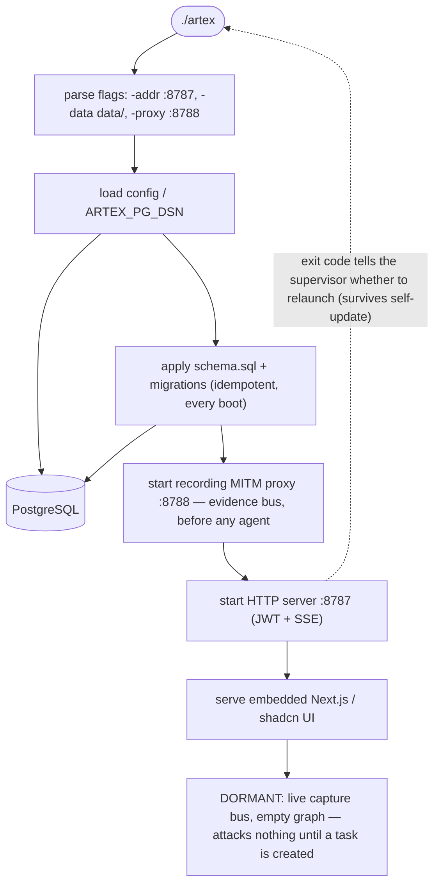

# 02 · Boot & launch — from `./artex` to a live console

This doc traces what literally happens between running the binary and having a UI you can click. It's
grounded in `original/cmd/artex/main.go` and the server/config packages.

## The shape of the deliverable

ARTEX builds to **a single Go binary** with the **Next.js UI embedded via `go:embed`**. The only
external dependency is **PostgreSQL**. So "install" is really "point the binary at a database and run
it." That one-binary design is deliberate — it's what makes an autonomous tool deployable as a systemd
unit or a one-shot Docker container without a frontend build step at the target.

> **DB note.** The upstream `main.go` banner comment still says "dual SQLite graph stores," but that's
> stale. The code loads a PostgreSQL DSN (`ARTEX_PG_DSN`) via `config`, and all three forks depend on
> `jackc/pgx/v5`. SQLite (`modernc.org/sqlite`) survives only as a secondary/vestigial dependency — the
> ymh `main.go` comment says as much: *"the PostgreSQL stores … SQLite survives only as …"*. The dual
> **graph** is Postgres.

## Step 0 — `main()` is tiny on purpose

```go
func main() { os.Exit(run()) }
```
`main` does nothing but map `run()`'s return onto the process exit code — *"The exit code is part of the
update protocol — the supervising start script reads it to decide whether to relaunch us (see
selfupdate.ExitRestart)"* (`original/cmd/artex/main.go`). This is the first design tell: ARTEX expects
to be run under a **supervisor** (`start.sh` / systemd) that can relaunch it, because a long autonomous
engagement has to survive a self-update without losing the task.

## Step 1 — flags & defaults

`run()` parses three flags (`original/cmd/artex/main.go`):

| Flag | Default | Meaning |
|---|---|---|
| `-addr` | `:8787` | HTTP listen address (UI + JSON API). |
| `-data` | `data/` next to the executable | Local data directory (traffic blobs, evidence store, cmd-output spill). |
| `-proxy` | `127.0.0.1:8788` | The **recording MITM proxy** address. Empty disables it. |

Two ports, two jobs: **8787** is the human/console plane; **8788** is the evidence plane every tool's
HTTP is funneled through. The proxy binds to loopback by default — it's an internal capture bus, not an
open proxy.

## Step 2 — configuration & the database DSN

Config loads from a JSON file if present, otherwise falls back to the environment:
`[config] 配置文件: … (不存在 — 将仅尝试环境变量 ARTEX_PG_DSN)` — "config file not found; will only try the env var
`ARTEX_PG_DSN`." The DSN is treated as **credential material that never gets serialized back out** (the
config struct carries `PGDSN` plus a `PGDSNSource` provenance tag, `BaaRai-ARTEX/config`), so a config
dump can't leak the database password.

## Step 3 — schema apply (idempotent)

On startup ARTEX **applies `db/schema.sql` and then the numbered migrations in `db/migrations/`
idempotently** — every launch re-asserts the full dual-graph schema (`assets`, `exploration_nodes`,
`exploration_edges`, `exploration_anchors`, `findings`, `finding_traffic_bindings`,
`traffic_evidence_snapshots`, scope and usage tables). BaaRai ships **14 incremental migrations**
applied on boot. The practical effect: upgrading the binary and restarting is a complete upgrade — the
database self-heals to the new shape, which is what lets a supervisor relaunch a freshly self-updated
binary mid-campaign without a manual migration step.

## Step 4 — the recording proxy comes up

Unless `-proxy` is empty, ARTEX starts the embedded **go-mitmproxy** on `:8788` with a generated CA
(`traffic/traffic.go`). From this point on, every HTTP exchange any tool makes — if routed through the
proxy — is captured in full plaintext and indexed. Workers are later launched with environment that
(a) points `HTTP(S)_PROXY` at `:8788` and (b) installs the proxy CA into every toolchain's trust store
(`SSL_CERT_FILE`, `REQUESTS_CA_BUNDLE`, `CURL_CA_BUNDLE`, `GIT_SSL_CAINFO`, `NODE_EXTRA_CA_CERTS` —
`BaaRai-ARTEX/agent/worker.go:250`). That's why findings can carry real receipts: capture is wired in
*before* any agent runs.

## Step 5 — the HTTP server + embedded UI

ARTEX starts `net/http` on `-addr` (`:8787`) with **JWT auth** and **Server-Sent Events** for live
updates. A `server.Manager` owns the lifecycle of tasks, engines, and stores. The Next.js SPA (built on
**shadcn/ui**) is served straight from the binary via `go:embed`, so the same origin serves the console
and the JSON API. The banner prints version, `GOOS/GOARCH`, Go version, and the listen address, and the
process blocks on `signal.Notify` for a clean shutdown.



## Step 6 — nothing is attacking yet

Crucially, **boot starts no engagement.** The engine's per-task goroutines (planner loop, workers,
claim-sweep) are spawned only when a *task* is created through the API/UI — see
[`03-input-to-findings-flow.md`](03-input-to-findings-flow.md). A freshly launched ARTEX is an idle
console with a live capture bus and an empty graph, waiting for a target. That separation (daemon up,
but dormant until tasked) is what makes it safe to run as a long-lived service.

## What this tells you about the design

- **One binary + Postgres** → trivially deployable autonomous agent; no frontend build at the target.
- **Supervisor + exit-code protocol** → built to survive self-update across a long campaign.
- **Idempotent schema on boot** → upgrades are restart-and-done; state is the database, not the process.
- **Capture bus before agents** → evidence is a property of the platform, not something an agent has to
  remember to do.

Next: [`03-input-to-findings-flow.md`](03-input-to-findings-flow.md) — what happens the moment you
actually give it a target.
