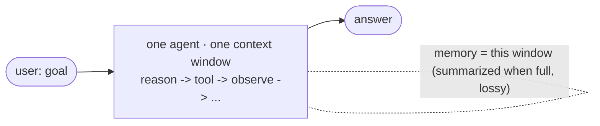
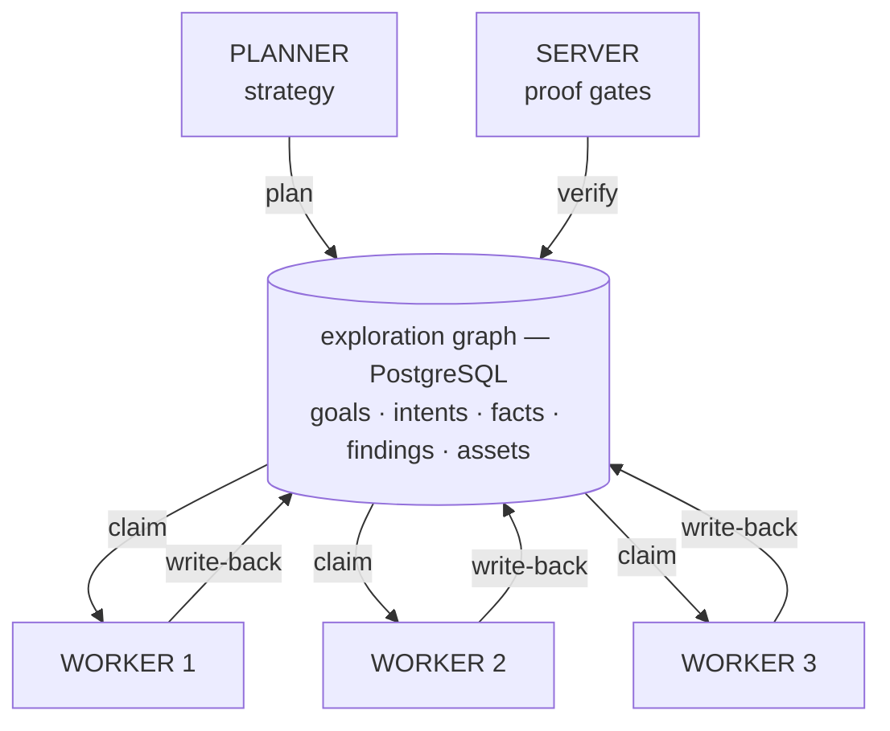

# 04 · ARTEX's engine vs a single-loop agent harness

The question this whole folder is really about: **why build a custom multi-agent engine when you could
just wrap the goal in an agent harness** — a Claude Code session, a Pi-style ReAct agent — **and let it
loop with tools?**

Both are "an LLM with tools in a loop." The difference is *where the state lives and who owns which
job*, and that difference is the entire reason ARTEX can run an eight-hour open-ended engagement that a
single-loop harness can't.

This doc is deliberately fair: §5 is the two places a harness is genuinely better.

---

## 1. The two shapes

### A single-loop agent harness (Claude Code, Pi-style ReAct)

One agent. One context window. It reasons, calls a tool, reads the result into the *same* context,
reasons again. Memory **is** the context window (plus whatever it writes to disk/todos). When the window
fills, the harness **summarizes** older turns to make room. Tools usually run behind a **permission
prompt**. It can often spawn **subagents**, but their job is to do a bounded sub-task and hand a summary
*back into the parent's one context*.

### ARTEX's engine (blackboard multi-agent)

Four jobs, four owners, state in a database:

- **Planner** — decides *what to explore*. Never touches the target.
- **Workers (×N)** — each do *one* thing against the target, then die.
- **The graph (PostgreSQL)** — the durable, shared memory.
- **The server** — *verifies* findings; the LLM never gets to declare victory.

The harness keeps everything in one head. ARTEX splits the one head into a committee with a shared
notebook and an auditor.

---

## 2. Component-for-component

| Concern | Single-loop harness | ARTEX engine |
|---|---|---|
| **Memory** | The context window; summarized on overflow (lossy). | Two PostgreSQL graphs; the window is scratch. Nothing important is ever summarized away. |
| **Who plans vs acts** | Same agent does both, interleaved. | Planner plans; workers act. Separable, concurrent. |
| **Parallelism** | One main loop; subagents help but report back into it. | N workers truly in parallel via lock-free DB claims. |
| **Picking up work** | Implicit — "what should I do next" re-derived each turn from context. | Explicit frontier of `open` intents, claimed by atomic compare-and-set. |
| **Knowing what's done** | Must remember / re-read its own transcript. | Node state machine (`open/running/done/exhausted/blocked`) + a coverage ledger. |
| **Cross-worker knowledge** | N/A (one agent) or lossy summaries from subagents. | `search_all_worker_traces` — any worker reads any other's raw trace. |
| **Verifying success** | The agent asserts it; you trust or re-check by hand. | Server re-checks captured bytes; `prove_goal` fails closed. |
| **Surviving provider/outage** | Loop breaks; you restart and lose in-flight context. | Provider failover + circuit breaker; state is in the DB, workers are disposable. |
| **Length of task** | Bounded by context before quality degrades. | Unbounded — cold-digest compaction keeps the planner's window small while history stays in Postgres. |
| **Tool execution** | Permission-gated by default (human in the loop). | `ModeBypass` — auto-executes (power ↑, containment ↓). |

---

## 3. The eight structural wins (restated as *what the harness can't do*)

1. **It can't forget safely.** A harness that summarizes its context *loses detail* — the exact error
   string, the hidden parameter, the half-finished chain. ARTEX never loses them: they're graph nodes.
   Cold-digest compaction (`agent/compaction.go`) shrinks the planner's *view* but keeps the data
   retrievable with `expand_digest`.
2. **It can't truly parallelize.** Subagents help, but their findings funnel back into one context that
   then becomes the bottleneck. ARTEX's workers write to the shared graph directly and never need to
   reconvene — N-way concurrency with zero merge step (`db/exploration.go:1173` atomic claim).
3. **It can't react to *another* actor's discovery mid-flight.** In a harness there's only one actor.
   In ARTEX, worker A's credential dump instantly reshapes what the planner hands worker B — emergent
   chaining the single loop structurally cannot produce.
4. **It can't tell "covered" from "ran out of budget."** A harness that stops mid-task just has a
   truncated transcript. ARTEX's distinct `done`/`exhausted`/`blocked` terminal states let the planner
   *retry the exhausted direction* and *drop the covered one* on purpose (`engine.go:1130`).
5. **It can't keep itself honest.** A harness will happily conclude "I found SQLi" from a suggestive
   response. ARTEX's server won't let a goal close without host-matched, encoding-decoded, verbatim-quote
   evidence from real captured traffic, and *demotes target-authored bytes* so they can't self-prove
   (`server/finding_verification.go`, `agent/tools.go:1878`).
6. **It can't share raw observation across parallel effort** — because there's no parallel effort to
   share across. `search_all_worker_traces` turns a team of workers into a shared sensorium.
7. **It can't resume a dead sub-task cleanly.** Kill a harness mid-tool and the context is gone. Kill an
   ARTEX worker and its intent is swept back to `open` (lease + heartbeat, `engine.go:1067`) and simply
   re-claimed — the graph already holds everything it wrote before it died.
8. **It can't hunt breadth deliberately.** A harness drifts along whatever thread is in its context.
   ARTEX has an explicit coverage denominator (`task_scope`) and `list_untested_assets`, so "go look at
   the surface we *haven't* touched" is a first-class move, not a hope.

The throughline: a single-loop harness collapses **plan / act / remember / verify** into one context. The
moment the task is longer than that context can faithfully hold — or needs real parallelism, or needs an
honest verdict — the collapse is the failure mode. ARTEX's whole architecture is *un-collapsing those
four jobs.*

---

## 4. A concrete divergence

Give both this goal: *"find and prove an exploitable issue across these 40 endpoints."*

- **Harness:** walks endpoints roughly in order, context filling with each one's output. By endpoint 25
  the early details are summarized to haze. It finds something suggestive on #7, but the request that
  triggered it has been compacted away, so its "proof" is a paraphrase. It tunnel-visions on the first
  promising lead because that's what's loudest in its context. One actor, one thread, degrading memory.
- **ARTEX:** the planner fans 3–4 intents across different endpoint *classes* at once; 3 workers run
  them in parallel; each writes assets/facts back to the graph with the **exact** proving exchange
  captured immutably. Worker 2's finding on #7 keeps its real request/response forever. The planner sees
  coverage climb, steers fresh workers at untested endpoints, and only closes the goal when the server
  re-verifies the captured bytes. Four jobs, four owners, durable memory.

---

## 5. Where the harness is actually better (the honest part)

A blackboard engine is not free. Two real costs, and the cases where a harness wins:

1. **Bounded, interactive, human-in-the-loop work.** For a task that fits one context and benefits from
   a human steering each step — most coding, debugging, "help me do X now" — a harness is *better*: lower
   latency, no orchestration overhead, permission prompts keeping you in control, and the full nuance of
   the task sitting in one coherent context instead of flattened into graph nodes. ARTEX's `ModeBypass`
   autonomy is exactly wrong for that. (This is why Claude Code is a harness, not a blackboard.)
2. **Engineering cost & brittleness.** ARTEX is a Go monolith with a Postgres schema, a MITM proxy, an
   evidence store, a verification layer, prompt-seeded agents, and an SDK. That's a *lot* of machine to
   build, run, and debug. A harness is a loop and a tool list. For anything that doesn't genuinely need
   durable state, parallelism, and machine-verified output, the blackboard is over-engineering.

The rule of thumb: **use a harness when the task fits one head and you want to stay in the loop; build a
blackboard when the task outlasts one context, needs many hands, and must prove its own results.**
Pentesting — long, open-ended, parallelizable, and worthless without proof — sits squarely in the second
bucket. That's why ARTEX is shaped the way it is.

---

## 6. The takeaway in one line

A single-loop harness is a brilliant *individual*. ARTEX is an *organization* — planner as strategy,
workers as hands, the graph as institutional memory, the server as auditor — and organizations beat
individuals precisely on the tasks that are too big, too long, or too consequential for one mind to hold.
