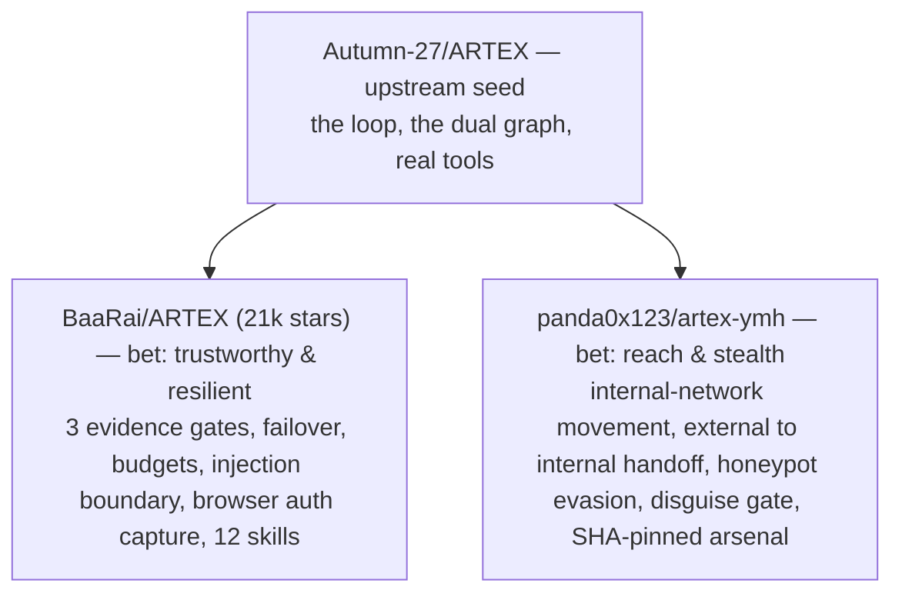

# 06 · Three forks, component by component — the good *and* the bad

The three repos share one engine but make different bets. This doc goes system by system and, for each,
says plainly what every fork does and the **trade-off** — because almost every choice here buys one thing
at the cost of another. Nothing is free.

Legend: **U** = `original/` (upstream seed) · **B** = `BaaRai-ARTEX/` (mainline) · **Y** = `artex-ymh/` (intranet fork).

---

## 1. The orchestration loop (planner ⇄ workers)

All three run the same blackboard loop: a planner dispatches intents, workers claim and execute them,
write-backs wake the planner (see [`03-input-to-findings-flow.md`](03-input-to-findings-flow.md)).

| | What it does | 👍 Good | 👎 Bad / cost |
|---|---|---|---|
| **U** | Planner goroutine + N workers + notify channel; 800 ms debounce. | Simple, legible, provably keeps moving (hard-floor rule). | No lease — a hung worker holds its intent until the process notices. |
| **B** | Adds a fencing-token **lease + heartbeat + claim-sweep** (`server/engine.go:1067`). | Survives a crashed/hung worker; the intent is swept back to `open`. | More moving parts; a too-short TTL can double-run an intent that was merely slow. |
| **Y** | Same loop, plus **phase orchestration** (`stage/`) that forks an internal subtask after a foothold. | One continuous external→internal campaign. | The handoff is extra state to reason about and debug; a mis-fire can launch internal work prematurely. |

**Design truth:** the loop's strength (reactive, never-scripted) is also its weakness — it's only as good
as the planner's judgment each round, and a bad intent wastes a whole worker run.

---

## 2. Intent claiming (concurrency control)

| | 👍 Good | 👎 Bad / cost |
|---|---|---|
| **U/B/Y** atomic CAS `UPDATE … WHERE state='open'` (`db/exploration.go:1173`) | Lock-free; N workers, zero coordination code, no double-work; trivially scales by adding workers. | Correctness leans entirely on one SQL invariant + a partial index. Drop the index or weaken the predicate and you silently get races. No priority fairness beyond `ORDER BY priority DESC`. |

**Design truth:** this is the most elegant thing in the codebase, and the most load-bearing. It's great
precisely because it's minimal — which also means there's nowhere to hide a bug.

---

## 3. The dual graph (memory)

| | 👍 Good | 👎 Bad / cost |
|---|---|---|
| Global **asset graph** + per-task **exploration graph** + anchors (all forks) | State outside the context window → long campaigns; DB-computed dedup/hierarchy keeps it consistent across agents; global assets carry knowledge between runs. | A *global* asset graph means one engagement's data is visible to the next — good for recon, bad for client data isolation if you run many clients on one instance (B leans on `companies`/`company_scope` to mitigate). Schema is heavy; "just try it" has a Postgres dependency. |
| **Cold-digest compaction** (all) | Bounded planner context on long runs; detail restorable via `expand_digest`. | Compaction is itself an LLM pass — it costs tokens and can fold something the planner later needed, adding a round-trip to get it back. |

**Design truth:** externalizing memory is the single best idea here; the price is a real database and a
schema you must respect.

---

## 4. Evidence & verification (is the finding real?)

This is where the forks diverge most.

| | What it does | 👍 Good | 👎 Bad / cost |
|---|---|---|---|
| **U** | `report_finding` binds traffic; anti-fabrication is mostly **prompt discipline** + a reporter that must cite evidence. | Lightweight; captures real request/response via the proxy. | The strongest guarantee is a *prompt rule* a `ModeBypass` model can slip. |
| **B** | **Three server-side gates** on `prove_goal`: host-matched live capture, L3+ verbatim-quote (gzip/deflate decoded), fact-to-activity provenance (`server/finding_verification.go`, `db/finding_traffic.go:600`). | Hard to hallucinate a closed goal; target-authored bytes can't self-prove; low false positives. | Strictness can *reject real findings* that lack a clean captured quote (e.g. out-of-band, timing, or binary-response bugs → `not_assessed`). More code = more to get right. |
| **Y** | **Per-class counter-evidence** in the `chains/` scaffolds: false positives written as `fact`, only confirmed issues become findings. | Cheap, class-aware false-positive filtering; good noise reduction. | It's heuristic, not a server re-check — weaker than B's cryptographic-grade receipt. |

**Design truth:** B trades *recall* for *precision* (it would rather miss a real bug than report a fake
one); U/Y trade the other way. Which is "better" depends on whether you're optimizing for trust or coverage.

---

## 5. Tools & execution

| | 👍 Good | 👎 Bad / cost |
|---|---|---|
| `PermissionMode: ModeBypass` + full Bash through a recording proxy (all) | Real pentester toolbox; automatic evidence capture; maximum autonomy. | **No human in the loop by default.** Auto-execution + removed authorization guard = high blast radius (see §12). |
| **Y** pinned arsenal (`tools-manifest.json`, SHA-256 verified) | Supply-chain integrity for the toolbox; reproducible. | More setup; a hash mismatch blocks a run until fixed. |

---

## 6. Provider resilience (LLM failover)

| | 👍 Good | 👎 Bad / cost |
|---|---|---|
| **U** basic retry/failover | Simple. | A provider outage can stall a run. |
| **B** ranked **pool + circuit breaker** (1/5/30-min ladder) + per-intent rotation (`llmpool/`) | Long runs survive outages/rate limits; load spreads across providers. | Rotation means different intents run on different models — subtle quality variance within one task; more config to get the ranking right. |
| **Y** OpenAI/Anthropic protocols | Straightforward. | Less failover machinery than B. |

---

## 7. Budgets (cost control)

| | 👍 Good | 👎 Bad / cost |
|---|---|---|
| **B** hierarchical task→intent→round budgets, fact-preserving wrap-up (`agent/budget.go`) | Caps spend without losing partial progress; graceful, not a hard kill. | **Off by default** — an unconfigured run has no token ceiling. Estimates (50k tokens/10 turns per worker) are coarse. |
| **U/Y** per-run `MaxTurns`/`MaxDuration` | Simple guardrail. | No whole-task budget; easy to burn tokens on a long campaign. |

---

## 8. Noise / rate control (stealth & politeness)

| | 👍 Good | 👎 Bad / cost |
|---|---|---|
| **B** `quiet/balanced/aggressive` token-bucket governor + scanner-flag mapping (`egress/`) | Tunable footprint; maps profile to real nmap/nuclei flags; 429/503 backoff. | **"Best-effort, not a security boundary"** — raw scanners rely on injected flags; a worker can still be noisy. |
| **Y** disguise gate + anti-mapping (`guard/`) | Decoy page for unauth requests; harder to fingerprint the agent itself. | Operational complexity; a decoy is one more thing that can misbehave or leak. |
| **U** none notable | — | Unpaced by default. |

---

## 9. Prompt-injection boundary

| | 👍 Good | 👎 Bad / cost |
|---|---|---|
| **B** nonce **data-envelope** wrapping target output + layered rules, on by default (`agent/data_envelope.go`) | Real defense for an agent that reads attacker-controlled responses all day; data can't add goals/scope or call `prove_goal`. | Not infallible — it's a prompt-level framing, not a type system; a determined injection in a weird encoding is still a risk. |
| **U/Y** — | Less emphasis. | A target's response is less strongly fenced from instructions. |

---

## 10. Authenticated-target capture

| | 👍 Good | 👎 Bad / cost |
|---|---|---|
| **B** MV3 **browser extension** (CDP capture → ingest) | Operator logs in once; the agent can attack authenticated surface (the majority of real apps). | Requires a human login step and a Chrome extension with broad debugger permissions; in-memory queue drops unsent entries on restart. |
| **U/Y** — | — | Authenticated surface is largely out of reach without manual setup. |

---

## 11. Skills (portable methodology)

| | 👍 Good | 👎 Bad / cost |
|---|---|---|
| **U** 3 skills | Lean. | Narrow methodology library. |
| **B** 12 skill packages (recon, API/web, code audit, binary RE, patch-diff) | Broad, reusable attack methodology; several lab-gated for safety. | More surface to maintain; some skills defer safety to a "best-effort tripwire, not a boundary." |
| **Y** `chains/` nine reasoning scaffolds | Class-specific guidance + counter-evidence. | Scaffolds are prompts, so quality tracks the model. |

---

## 12. Safety / authorization posture (the big one)

| | Posture | 👍 Good | 👎 Bad / cost |
|---|---|---|---|
| **U** | Authorization-scope guard **removed**; destructive-shell rule on, exfil rule **off** by default; fail-open defaults (`guard/guard.go`, `db/db.go:536`). | Maximum autonomy; nothing gets in the agent's way. | **Low containment** — the central flaw. A `ModeBypass` agent with soft, disable-able rules can act well outside intent. |
| **B** | Adds the nonce boundary + the target gate (off by default, API-only) + intercept rules. | More guardrails available. | Several are **off by default**, so safety depends on operator config. |
| **Y** | Re-introduces **RoE scope modes** (off/warn/strict) + scope-expansion approval + disguise gate. | The strongest built-in operational guardrails of the three. | Still optional; strict mode trades autonomy for control. |

**Design truth:** across all three, *capability is high and containment is opt-in*. Y claws back the most
safety; none is safe-by-default. This is the defining tension of the whole project.

---

## 13. Internal-network reach (Y only)

| | 👍 Good | 👎 Bad / cost |
|---|---|---|
| **Y** `session/` + `tunnel/` + credential store + topology graph | Turns a single foothold into a whole internal campaign; newly reachable assets flow back into the same planner loop. | The most sensitive capability surface of the three; far more that can go wrong, and the honeypot/anti-mapping layer exists precisely because this is dangerous on a real network. |

---

## 14. Deployment & supply chain

| | 👍 Good | 👎 Bad / cost |
|---|---|---|
| **All** one Go binary + embedded UI + Postgres | Trivial to deploy; idempotent schema on boot; systemd/Docker friendly. | Postgres dependency; a big binary. |
| **B** SBOM, SHA256SUMS, build provenance, govulncheck, `hardening/` rule tests | Verifiable releases; CI-checked safety rules. | Maintenance overhead. |
| **Y** `artex doctor` preflight + pinned tools | Catches a broken toolbox before a run. | More setup steps. |

---

## Which to read / use when

- **Learn the engine →** `original/` (U). The smallest version of every idea, nothing extra.
- **Run something you can trust →** `BaaRai-ARTEX/` (B). The evidence gates, failover, budgets, and
  injection boundary are what make an *unattended* run credible. It's the strongest baseline.
- **Study internal-network autonomy →** `artex-ymh/` (Y). The pivot stack and OPSEC layer are unique,
  and it has the best built-in RoE controls — but it's also the sharpest tool in the drawer.

The honest one-liner: **U is the clearest teacher, B is the one you'd actually deploy, Y is the most
capable and the most dangerous.** Every upgrade in reach or trust was paid for in complexity or
containment — which is the real lesson of reading three forks side by side.
